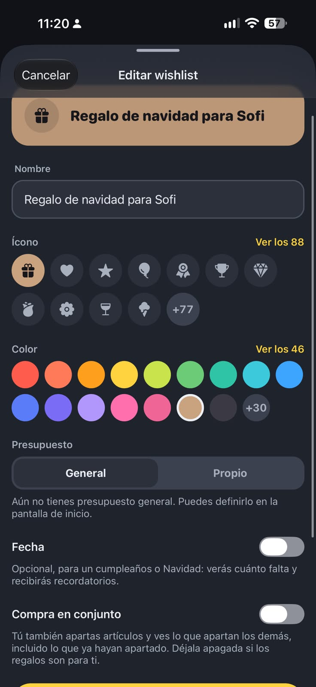
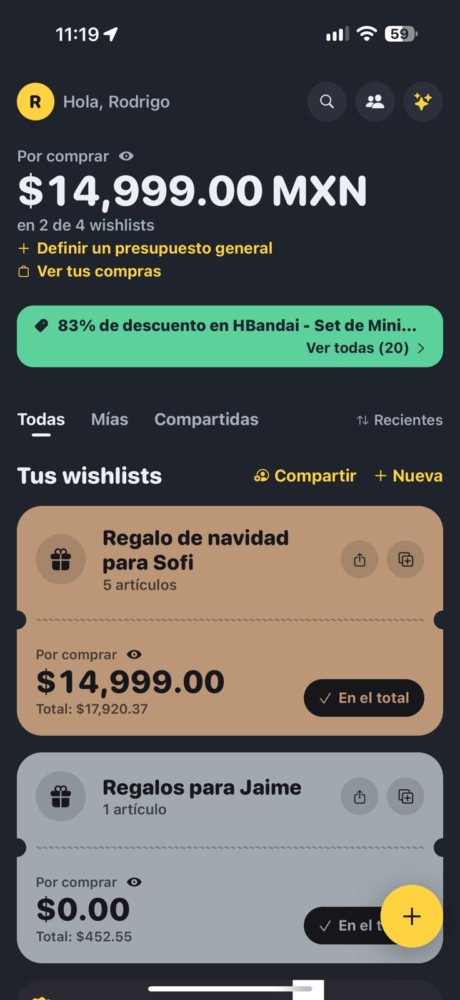
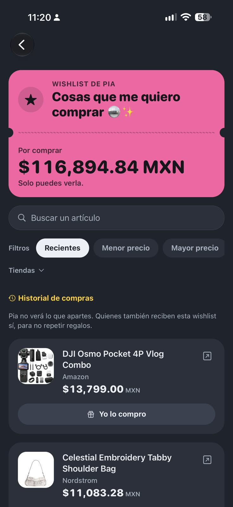
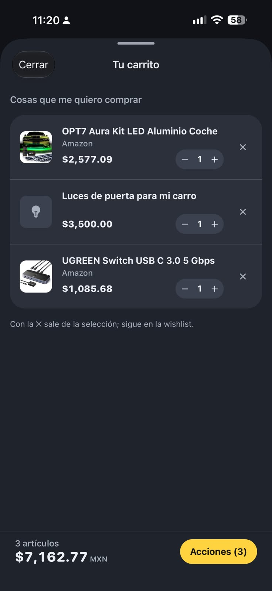
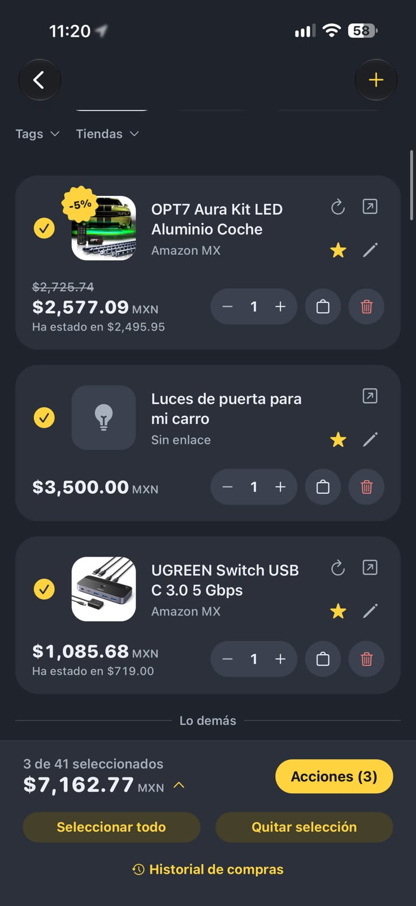
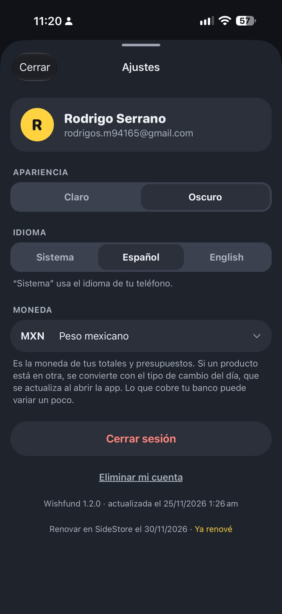
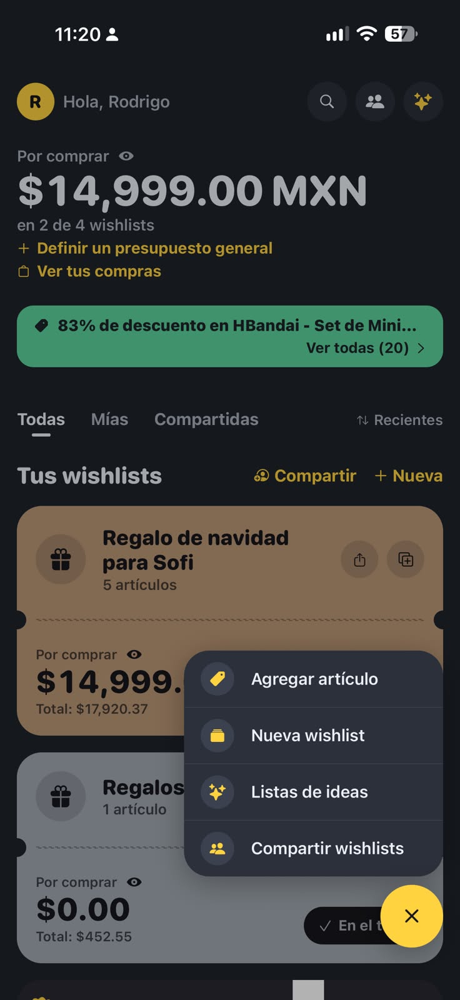
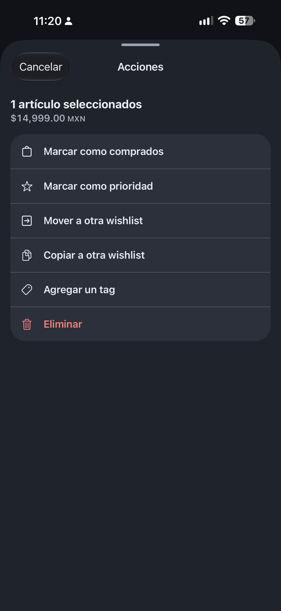
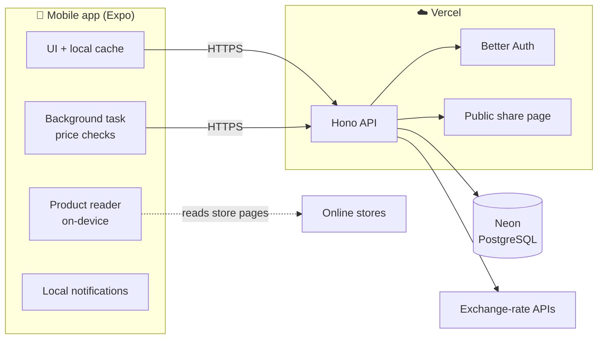

# Wishfund

**A cross-platform wishlist app (iOS & Android) that tracks prices, budgets, and shared gift lists.**

Save products from any online store, organize them into wishlists, get notified when prices drop, and share lists with friends and family so nobody buys the same gift twice.

> 🔒 **Source code is private.** This repository is a showcase of the product, its architecture, and the technical decisions behind it. Code walkthrough available upon request.

<!-- Add screenshots to /screenshots and update the paths below -->

  
  
  
  

  
  
  
  
  

---

## Features

**Wishlists & products**
- Multiple wishlists with icon, color, optional budget and event date (birthday, Christmas)
- Add products by pasting or sharing a link from any store app — name, price and image are filled in automatically
- Quantities, priorities, notes, tags, search, sorting and filtered views
- Totals per list, per selection and across all lists, plus a cart view with bulk actions (mark purchased, move, copy, tag, reserve, delete)

**Price tracking**
- Automatic price checks while the app is open and in the background
- Price-drop alerts with the previous price struck through and the discount percentage
- Price history chart per product and lowest price seen
- Detects products a store has removed

**Multi-currency**
- 10 supported currencies; each account picks its own
- Prices from foreign stores are converted with daily exchange rates, keeping the original price
- A price drop only counts when the store price changes, not when the exchange rate moves

**Sharing & gifting**
- Share a wishlist with another account as view-only or view-and-edit
- Public read-only link that opens directly in the app
- Reserve items on a received wishlist so gifts aren't duplicated
- Optional "joint purchase" mode with a shared tally of who buys what
- Purchase notices with a configurable delay, so an accidental tap can be undone before anyone is notified
- Per-wishlist purchase history

**Other**
- English and Spanish, switchable instantly and offline
- Light and dark theme
- Offline cache with instant load and undo on delete
- Date reminders (7 days before, 1 day before and on the day)
- Email/password sign-up with verification code, plus Google and Microsoft sign-in

---

## Tech stack

| Layer | Technology |
|---|---|
| Mobile app | React Native, Expo, Expo Router, TypeScript |
| API | Hono on Vercel serverless functions |
| Database | Neon (serverless PostgreSQL), Drizzle ORM and migrations |
| Auth | Better Auth (email + verification code, Google, Microsoft) |
| Email | Resend |
| Validation | Zod |
| CI/CD | GitHub Actions (iOS and Android builds), EAS Update for over-the-air updates |
| Development | AI-assisted development with Claude Code |

---

## Architecture

- The app never talks to the database directly; every query is scoped to the signed-in user by the API.
- Store pages are read **on the phone**, not on the server (see below).

---

## Technical highlights

**Reading products from any store link.** Several large marketplaces block requests coming from cloud servers, so product extraction runs on the device in up to three steps: a fast request that reads structured data (JSON-LD, Open Graph, microdata); a hidden in-app browser for pages that build their content with JavaScript; and, as a last resort, a best-effort fill that is clearly flagged as approximate. A price is never invented — if it can't be read, the user enters it.

**Consistent purchases under concurrency.** Marking an item as purchased runs in a single database transaction that locks the affected rows, so simultaneous taps from different users never duplicate or lose a purchase. Conflicting reservations return a clear `409` to the second user.

**Currency handling.** Every product stores its price in the account's currency for totals and budgets, plus the original store price and currency. Exchange rates are cached and refreshed every few hours with a fallback source, and changing the account currency converts prices, budgets, history and purchases while keeping the original values.

**Data model.** 35 incremental migrations covering products, price history, wishlist items, purchases, purchase notices, shares, friendships and settings. A product exists once per link per user, so editing or updating it applies to every list that contains it.

**Shipping without an app store (yet).** Builds for iOS and Android are produced by GitHub Actions, and code-only changes are delivered over the air with EAS Update, with versioning rules so an update never reaches an install that lacks a required native module.

**Internationalization.** All UI strings ship with the app (no network needed to switch language); the API localizes its errors, emails and public pages from the request's `Accept-Language` header.

---

## Status

- ✅ Running in production on iOS and Android (API and database live)
- 🔜 App Store / Google Play release
- 🔜 Push notifications and Sign in with Apple

---

## Author

**Mariano Serrano Meneses** — Software Engineer
[LinkedIn](https://www.linkedin.com/in/mariano-serrano-meneses) · Guadalajara, Mexico
